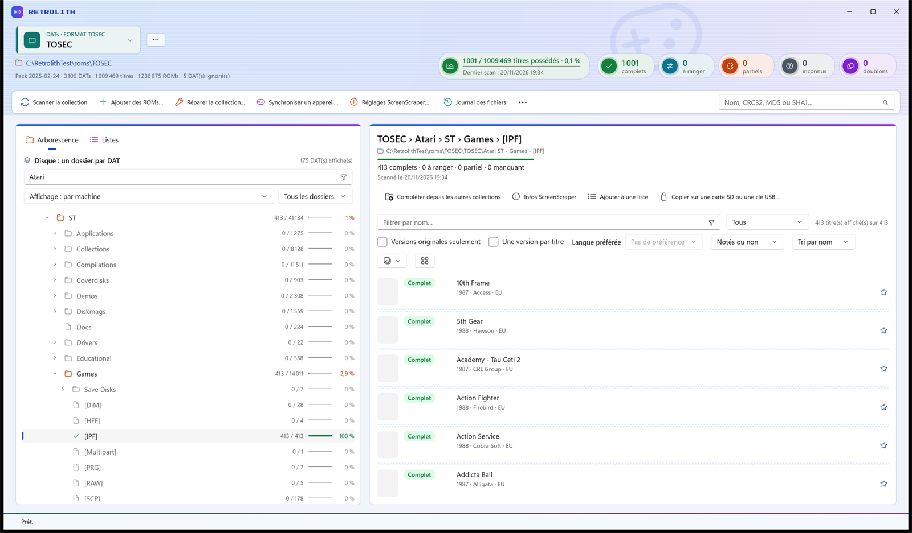
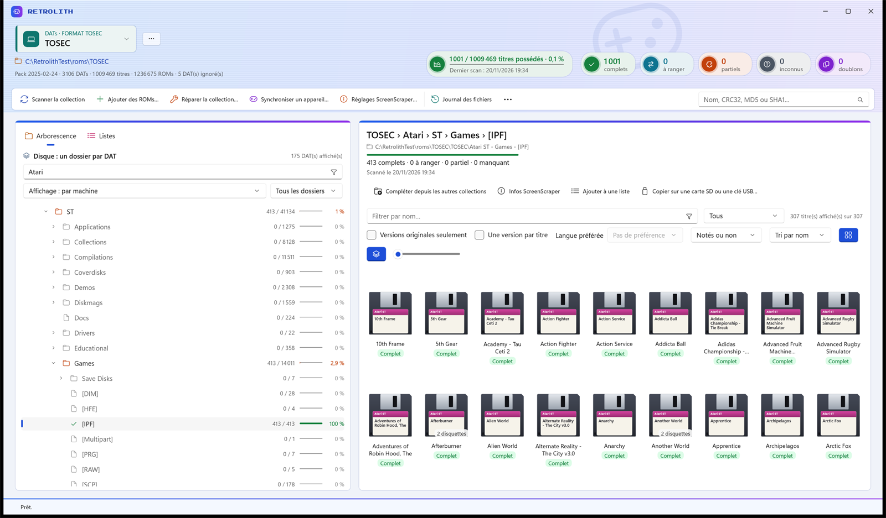
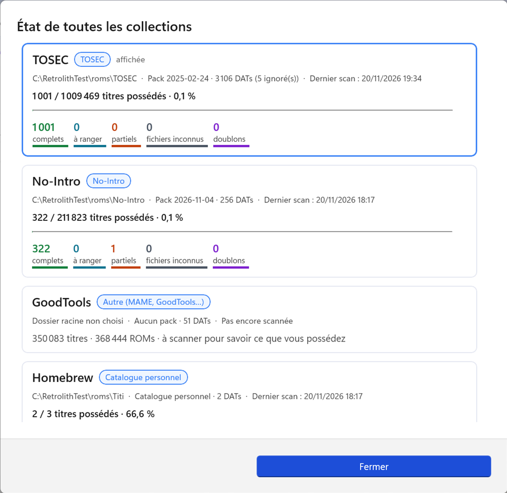
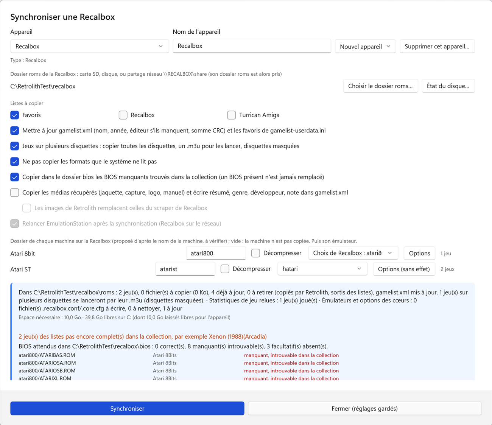

# Retrolith

**[English](README.md)** · Français

**Gestionnaire de collections de jeux rétro pour Windows.** Retrolith compare vos ROMs aux catalogues de référence
(fichiers DAT de TOSEC, No-Intro, Redump, MAME, FinalBurn Neo…) ou à vos propres catalogues, vous dit ce qui est
complet, mal rangé, manquant ou inconnu, range vos fichiers dans les zips officiels, et copie vos jeux sur une
Recalbox, une Batocera, un MiSTer ou dans LaunchBox.

Retrolith est gratuit. Il ne contient et ne télécharge aucun jeu : il gère les copies que vous possédez.

## Ce qu'il fait

- **Toutes les sortes de DATs** : TOSEC, No-Intro, Redump (pistes `.cue`/`.bin`, jeux sur plusieurs disques, CHD),
  MAME et FinalBurn Neo (parents, clones, BIOS, sets split, merged ou non-merged), GoodTools, DATs WHDLoad, et vos
  propres catalogues. Le format des noms est reconnu tout seul à l'import.
- **Scan rapide** des dossiers, des zips et des 7z : chaque jeu est complet, à ranger, partiel ou manquant ; les
  fichiers inconnus et les doublons sont comptés.
- **Rangement sûr** : « Ajouter des ROMs… » et « Réparer la collection… » montrent un aperçu avant de toucher au moindre
  fichier ; chaque zip est vérifié avant de remplacer l'ancien, et rien n'est effacé sans passer par la corbeille.
- **Conversion cue/bin ↔ CHD** avec chdman, vérifiée face au DAT.
- **Infos et médias** depuis ScreenScraper (compte gratuit) : résumé, genres, note, boîtes, captures, manuels ; ou vos
  propres images.
- **Listes** : favoris, listes personnelles et listes intelligentes par règles (genre, note, « jamais joué »,
  « tient sur 64 Go »…).
- **Synchronisation** avec Recalbox, Batocera, MiSTer et LaunchBox : jeux, `gamelist.xml`, `.m3u` des jeux sur plusieurs
  disques, médias, BIOS manquants, émulateur par machine ou par jeu ; favoris, statistiques de jeu et sauvegardes
  reviennent dans Retrolith.
- **Interface en français et en anglais**, sauvegardes de la base, dossier de données partagé entre plusieurs PC.

| | |
|---|---|
|  |  |
| **Grille** : jaquettes, ou le support du jeu dessiné par Retrolith | **État de toutes les collections** d'un coup d'œil |
|  | |
| **Synchroniser un appareil** : listes, `gamelist.xml`, `.m3u`, BIOS, émulateurs | |

## Télécharger et installer

1. Téléchargez le dernier `Retrolith-<version>-win-x64.zip` sur la page des
   **[versions](https://github.com/TiticBE/Retrolith/releases/latest)**.
2. Décompressez-le où vous voulez (par exemple `C:\Retrolith` ou une clé USB) et lancez **`Retrolith.exe`**.

Rien d'autre à installer. Retrolith est portable : ses données (base, réglages, médias) sont gardées dans le dossier
`Data`, à côté de l'exécutable. Les nouvelles versions sont proposées au démarrage et s'installent d'un clic.

**Configuration** : Windows 10 (version 1809 ou plus récente) ou Windows 11, 64 bits (x64).

### Avertissement de Windows au premier lancement

Retrolith n'est pas encore signé numériquement. Au premier lancement, Windows peut afficher « Windows a protégé votre
ordinateur » : cliquez sur **Informations complémentaires**, puis **Exécuter quand même**. Cet avertissement vient de
ce que le fichier est récent et peu téléchargé, pas d'un problème détecté. La somme SHA-256 de chaque zip est publiée à
côté de lui (`.sha256`) si vous voulez le vérifier.

## Premiers pas

1. **Créez une collection** (écran d'accueil) : une collection de DATs, ou un catalogue personnel.
2. **Importez ses DATs** : le pack zippé ou un dossier de DATs.
3. **Choisissez son dossier racine**, celui où sont (ou seront) vos ROMs.
4. **Scannez la collection**, puis ajoutez des ROMs ou réparez ce qui est à ranger.

Le guide détaille chaque étape : **[Guide de l'utilisateur](docs/fr/index.md)**.

## Aide et suggestions

- Une question, une idée, un mot sur Retrolith : écrivez dans les
  **[Discussions](https://github.com/TiticBE/Retrolith/discussions)** (en français ou en anglais).
- Quelque chose qui ne marche pas : ouvrez un **[ticket](https://github.com/TiticBE/Retrolith/issues)**. Joignez si
  possible le diagnostic (menu « ⋯ » › « Diagnostic » › « Copier le diagnostic »).
- Les questions courantes : **[FAQ](docs/fr/faq.md)**.

## Licence

Retrolith est un freeware : gratuit pour un usage personnel et non commercial, code fermé, tous droits réservés. Voir
`LICENSE.txt` dans le zip, ainsi que `THIRD-PARTY-NOTICES.txt` pour les composants tiers.

Merci aux projets dont Retrolith utilise les données : TOSEC, No-Intro, Redump, MAME, FinalBurn Neo, ScreenScraper et
Recalbox.
