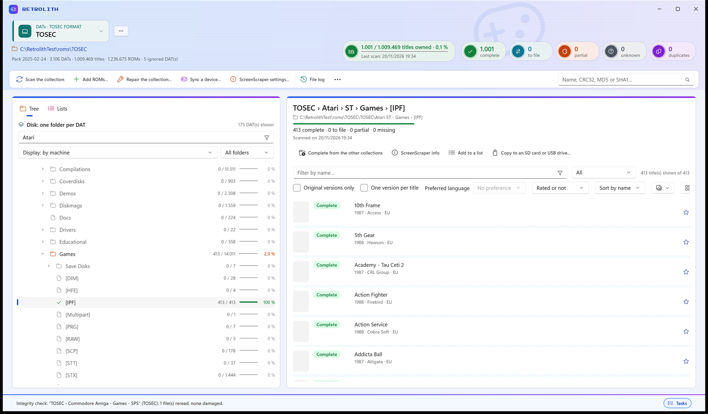
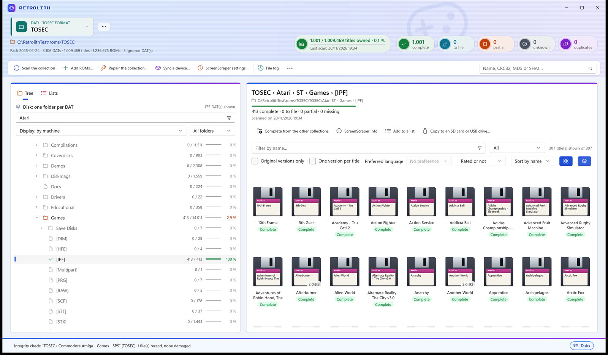
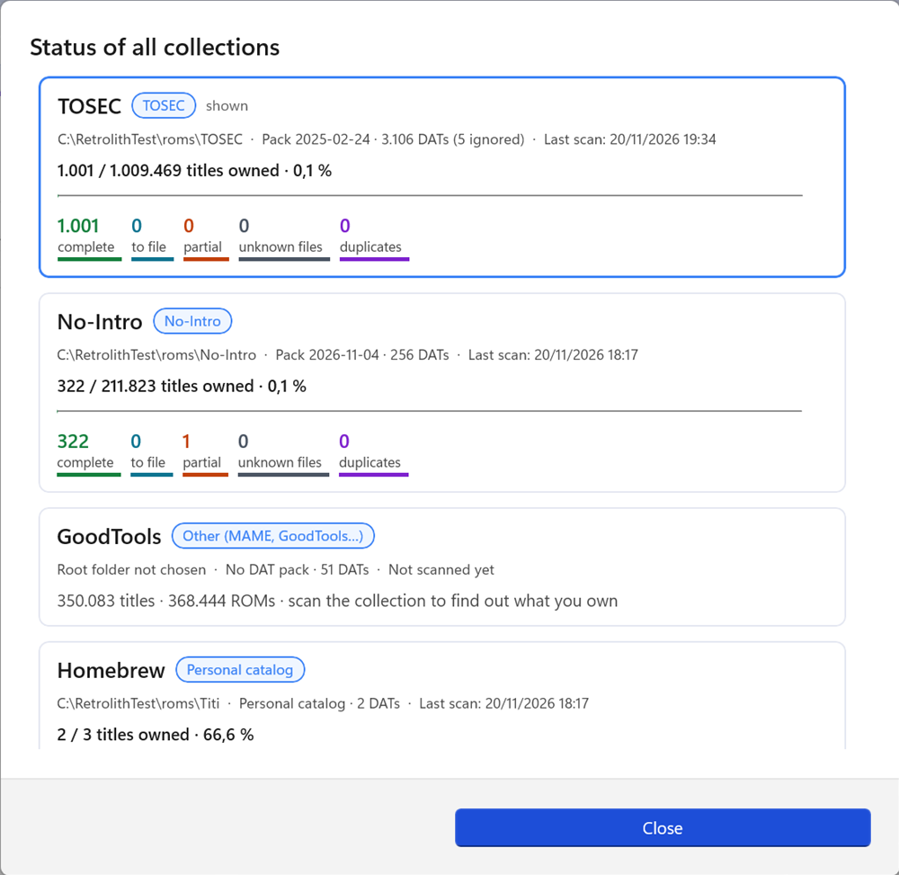
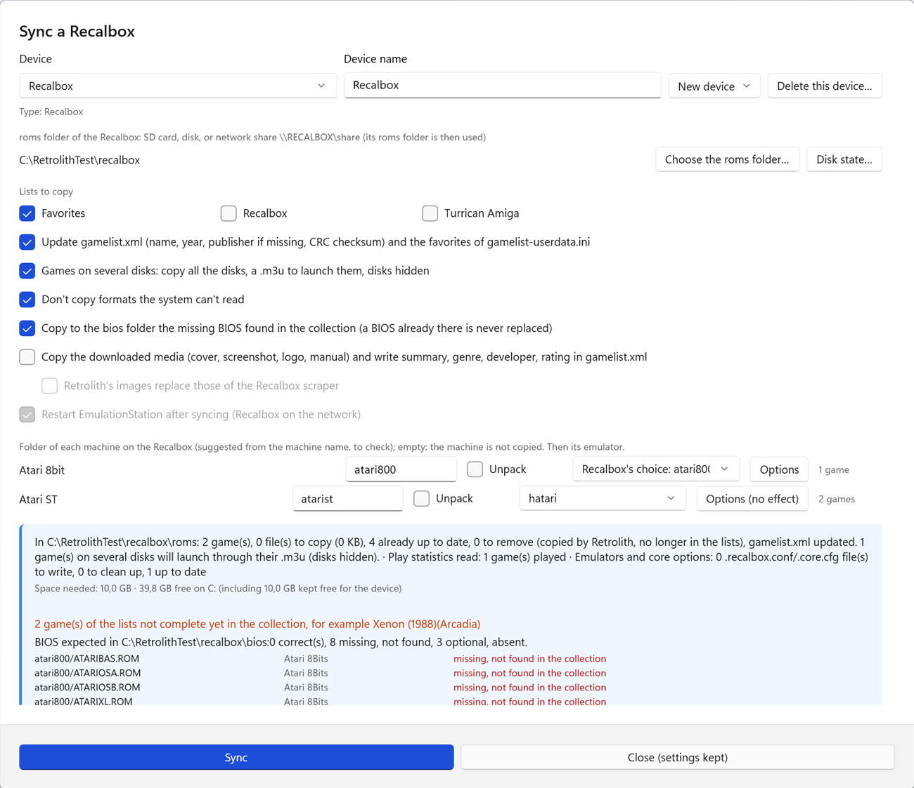

# Retrolith

English · **[Français](README.fr.md)**

**A retro game collection manager for Windows.** Retrolith checks your ROMs against reference catalogs (DAT files from
TOSEC, No-Intro, Redump, MAME, FinalBurn Neo…) or your own catalogs, tells you what is complete, misplaced, missing or
unknown, files everything into the official zips, and copies your games to a Recalbox, a Batocera, a MiSTer or
LaunchBox.

Retrolith is free. It contains and downloads no games: it manages the copies you own.

## What it does

- **Every kind of DAT**: TOSEC, No-Intro, Redump (`.cue`/`.bin` tracks, multi-disc games, CHD), MAME and FinalBurn Neo
  (parents, clones, BIOS, split, merged or non-merged sets), GoodTools, WHDLoad DATs, and your own catalogs. The naming
  format is recognised on import.
- **Fast scan** of folders, zips and 7z archives: each game is complete, to be filed, partial or missing; unknown files
  and duplicates are counted.
- **Safe filing**: "Add ROMs…" and "Repair the collection…" show a preview before touching any file; every zip is
  verified before it replaces the old one, and nothing is deleted without going through the recycle bin.
- **cue/bin ↔ CHD conversion** with chdman, checked against the DAT.
- **Info and media** from ScreenScraper (free account): summary, genres, rating, boxes, screenshots, manuals; or your
  own images.
- **Lists**: favorites, personal lists and rule-based smart lists (genre, rating, "never played", "fits in 64 GB"…).
- **Sync** with Recalbox, Batocera, MiSTer and LaunchBox: games, `gamelist.xml`, `.m3u` for multi-disc games, media,
  missing BIOS, emulator per machine or per game; favorites, play statistics and save files come back into Retrolith.
- **English and French interface**, database backups, a data folder shared between several PCs.

| | |
|---|---|
|  |  |
| **Grid view**: covers, or the game's media drawn by Retrolith | **Status of all collections** at a glance |
|  | |
| **Sync a device**: lists, `gamelist.xml`, `.m3u`, BIOS, emulators | |

## Download and install

1. Download the latest `Retrolith-<version>-win-x64.zip` from the
   **[releases page](https://github.com/TiticBE/Retrolith/releases/latest)**.
2. Unzip it anywhere (for example `C:\Retrolith` or a USB drive) and run **`Retrolith.exe`**.

Nothing else to install. Retrolith is portable: its data (database, settings, media) lives in the `Data` folder next to
the executable. New versions are offered at startup and install in one click.

**Requirements**: Windows 10 (version 1809 or later) or Windows 11, 64-bit (x64).

### Windows warning on first launch

Retrolith is not digitally signed yet. On first launch Windows may show "Windows protected your PC": click **More
info**, then **Run anyway**. The warning comes from the file being new and rarely downloaded, not from anything
detected. Each zip's SHA-256 checksum is published next to it (`.sha256`) if you want to check it.

## Getting started

1. **Create a collection** (welcome screen): a DAT collection or a personal catalog.
2. **Import its DATs**: the zipped pack or a folder of DATs.
3. **Choose its root folder**, where your ROMs are (or will be).
4. **Scan the collection**, then add ROMs or repair what needs filing.

The guide covers every step: **[User guide](docs/en/index.md)**.

## Help and suggestions

- A problem or an idea: open an **[issue](https://github.com/TiticBE/Retrolith/issues)**. If you can, attach the
  diagnostics ("⋯" menu › "Diagnostics" › "Copy the diagnostics").
- Common questions: **[FAQ](docs/en/faq.md)**.

## License

Retrolith is freeware: free for personal, non-commercial use, closed source, all rights reserved. See `LICENSE.txt` in
the zip, and `THIRD-PARTY-NOTICES.txt` for third-party components.

Thanks to the projects whose data Retrolith uses: TOSEC, No-Intro, Redump, MAME, FinalBurn Neo, ScreenScraper and
Recalbox.
