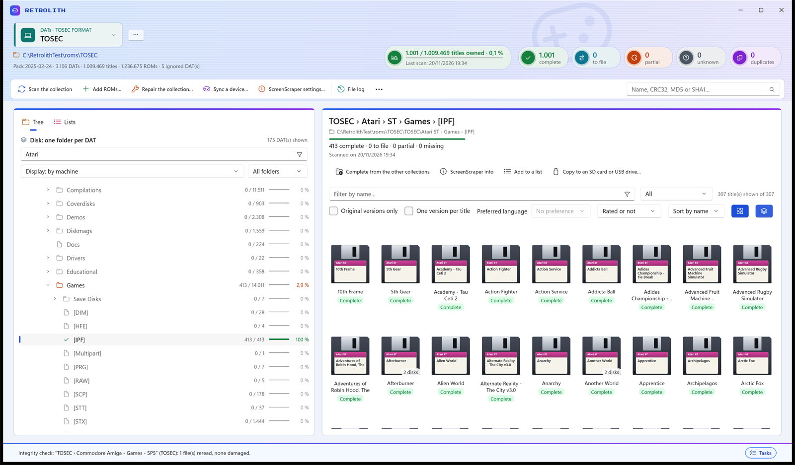

# Browsing and lists

[← Contents](index.md)

## Tree, list and grid

On the left, the collection's **tree**, with the percentage of titles owned at every level. Above it: the display (by
machine or by DAT) and a filter (all folders, incomplete…). Drag its edge to resize it.

On the right, the titles of the chosen folder:

- **as a list**, one row per title, with its badges and state;
- **as a grid**, one tile per game with its cover (box, else media, else title screen), LaunchBox style; a slider sets
  the tile size. A game without an image is drawn on its media (floppy disk, tape, cartridge, CD).

In the grid, the disks, sides, tapes or discs of one game share a single tile ("4 disks", "3/4 disks" if some are
missing). A button next to it switches back to one tile per disk.

A folder that is not a DAT ("Atari › ST") shows the titles of all its DATs. Beyond 100,000 titles nothing is loaded:
pick a subfolder or search.

## Filters

- **Original versions only**: no cracks, hacks, trainers, translations…
- **One version per title**: keeps the best version of each game (verified dump, then original, final release, your
  preferred language, owned version, most recent).
- Ownership, rating, version types: only those found in the collection's names are offered.

## Search

The search box at the top right searches the whole collection: by name (or by a game inside a compilation), or by
checksum (pasted CRC32, MD5 or SHA1). It can be filtered by machine, version type, ownership, rating and genre. **Make it
a smart list…** keeps the search as a list.

## Game details

Double-click a game to open its details: its files and their state, info and media, the other versions and collections
it appears in, your notes, its tags, its play statistics on your devices, its saves, and the emulator chosen for it.

## Ratings and tags

- **Rating**: yours, out of 20, or ScreenScraper's. It applies to every version of the title, in every collection, and is
  used for sorting and filtering.
- **Personal notes**: free text in the details.
- **Tags** ("Two players", "Kids"…): in the details, for every version of the game; usable in smart lists.

## Favorites and lists

The **Lists** tab, next to the tree, and right-click on a game.

- **Favorites**: right-click › **Add to favorites**.
- **Personal lists**: **New list…**, then right-click a game › **Add to a list**. Lists follow games from one pack to the
  next, even renamed.
- **Smart lists**: **Smart list (by rules)…**. Rules on machine, folder, name, version type, ownership, rating, genres,
  game modes, series, your tags, games played on your devices ("never played", "played in the last 30 days"), one
  version per title. The list is recalculated after every scan and every sync.
- **Maximum size**: a smart-list rule that keeps the best-rated titles as long as they fit in a given size. **Read device
  space** fills it from a device, leaving a reserve for its cache and saves.

A game on several disks or discs enters a list with all its parts.
