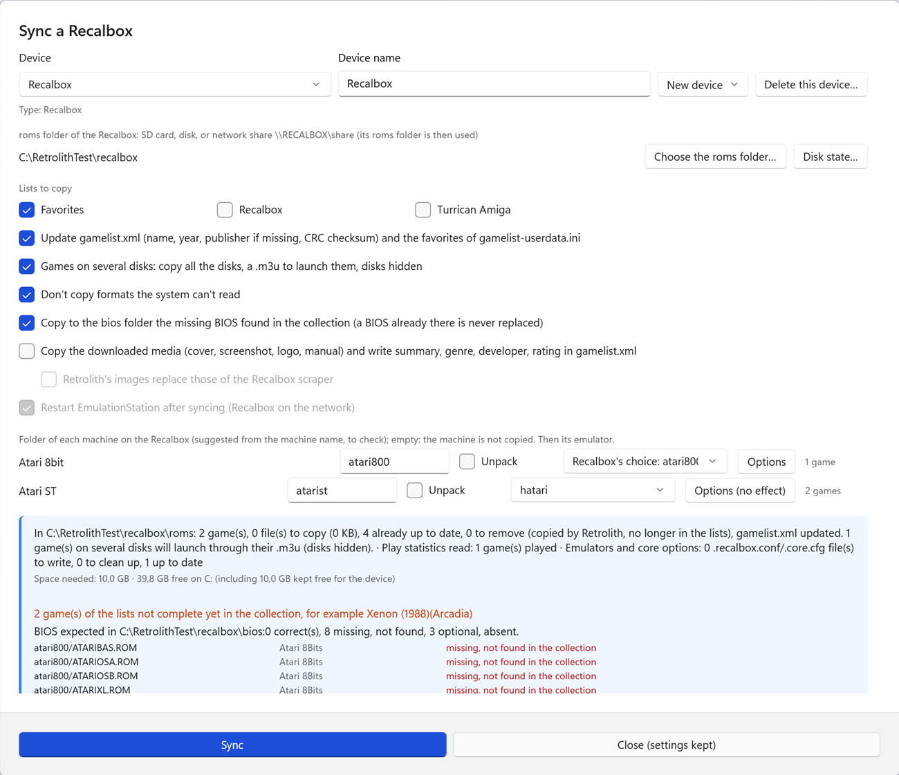

# Devices

[← Contents](index.md)

Retrolith copies your games to your devices and keeps track of what it put there. **Sync a device…** (toolbar) opens the
profiles window: one profile per device, with its folder or network share, the lists to send and its options. The window
only shows the options that kind of device supports.

## Common principles

- **Only complete games** from the chosen lists are copied.
- A **preview** shows what will be copied, replaced or removed, and the space needed.
- Retrolith **only removes what it put there itself**; removed files go to `_Retrolith Trash` on the device.
- A **reserve** of space (5% of the disk, between 2 and 10 GB) is left to the device for its cache, saves and
  screenshots.
- **Changes on the device come back**: a favorite added or removed on the device is too in Retrolith; the side that
  changed since the last sync wins, and the preview shows it. **Play statistics** (sessions, time played, last played)
  are read back and shown in the game details.

## Recalbox

Folder: the SD card, a disk, or the `\\RECALBOX\share` network share.

- Each game goes into its machine's folder; `gamelist.xml` is completed (name, year, publisher, favorites, media,
  summary, manual, genre) without overwriting what Recalbox wrote.
- **Multi-disk or multi-disc games**: an `.m3u` launches them, and the individual disks are hidden.
- **Games with several tracks**: copied unzipped, sheet and tracks side by side; a game owned as `.chd` goes as `.chd`.
- **Readable formats**: games a Recalbox system cannot read (according to its `_readme.txt`) are reported and left out.
- **Emulator per machine and per game**: in the profile, each machine can use one of Recalbox's emulators; in a game's
  details, an emulator for that game. The choice is written to the `.recalbox.conf` files next to the ROMs; a key written
  by hand is kept, and reported.
- Core **options** (machine model: Atari ST, Amiga, Thomson, Atari 8-bit…), per machine or per game, in `.core.cfg`
  files.
- **BIOS**: the `bios` folder is checked against Recalbox's own list, and missing BIOS found in the collection are
  copied.
- **Disk state…**: read without writing anything, it shows Retrolith's files, orphans from old syncs, copies made by hand
  (to adopt into a list), unknown, missing or damaged files, and the space per machine. Clean-up is chosen file by file.
  Recalbox's own files (`gamelist.xml`, saves, BIOS…) are never touched.
- Over the network, EmulationStation can be restarted at the end.

## Batocera

Set up like a Recalbox: `roms` folder or `\\BATOCERA\share`, each machine's folder under its Batocera name, `.m3u`,
`gamelist.xml` with favorites and media, missing BIOS copied. Readable formats are taken from each system's `_info.txt`.
Over the network, Retrolith reloads the game lists at the end, once **Enable public web access** is turned on in
Batocera's developer options.

## MiSTer

Copies into `games\<core>` on the SD card, a USB drive or a share (NES, SNES, MegaDrive, PSX, Amiga…), without game
lists. Missing BIOS are placed in the core's folder under the name it expects (`boot0.rom`…).

## LaunchBox

A LaunchBox profile (Windows) copies games into their platform's games folder and registers them in
`Data\Platforms\<platform>.xml`; each list becomes a playlist, favorites the "Favorite" box, and media go into the image,
video and manual folders. A game already in LaunchBox is reused as is. Retrolith refuses to write while LaunchBox or Big
Box is running, and backs up each XML file before rewriting it (`Backups\Retrolith`).

## SD card or USB drive

**Copy to an SD card or USB drive…** (toolbar): a folder's complete games, with the same filters, zipped or unzipped.
Running the copy again updates the card.

## Game saves

At every sync Retrolith collects game saves from the device, never modifying anything there:

- **Recalbox**: cartridge saves (`.srm`), save states (`.state`…) with their screenshots, save disks, Amiberry states;
- **Batocera** and **MiSTer**: saves and save states;
- **LaunchBox**: saves of the emulator launched for each game (RetroArch, Hatari, Altirra, WinUAE, Amiga Forever).

Each save keeps its last 20 versions (except those marked **Always keep**). The game details show them; **Restore
to…** puts a version back on a device where the game runs with the same core, always keeping the file in place first.
A save can thus move from one Recalbox to another, or from a Recalbox to LaunchBox. Restoring to Batocera and MiSTer is
not possible yet.
