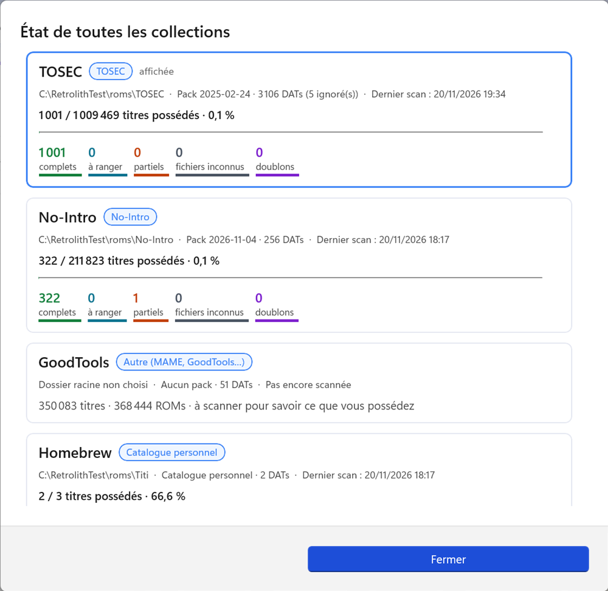

# Collections et DATs

[← Sommaire](index.md)

## Plusieurs collections

Retrolith gère autant de collections que vous voulez. Chacune a son pack de DATs, son dossier racine, ses listes et ses
appareils. Le menu de la collection (à côté de son nom) permet de :

- passer d'une collection à l'autre ;
- voir l'**État de toutes les collections…** : une carte par collection, avec le dernier scan, les titres possédés,
  complets, à ranger, partiels, les inconnus et les doublons ;
- ouvrir la **Vue par machine…** : tous les titres d'une machine, toutes collections confondues ;
- créer une **Nouvelle collection…**, renommer ou retirer la collection affichée (la retirer n'efface aucun de vos
  fichiers).

## Formats des noms

Toutes les collections de DATs marchent de la même façon ; seul change le format des noms de fichiers, reconnu au
premier import :

| Format | Reconnu par | Rangement sur le disque |
|---|---|---|
| **TOSEC** | `(TOSEC-v…)`, branches `TOSEC`, `TOSEC-ISO`, `TOSEC-PIX` | Un dossier par DAT (`Commodore Amiga - Games - [ADF]`), ou l'arborescence officielle (`Commodore\Amiga\Games\[ADF]`) |
| **No-Intro** | Date dans le nom du DAT, « No-Intro » ou « redump » dans l'en-tête | Un dossier par système |
| **Autre** | Tout le reste : MAME, FinalBurn Neo, GoodTools, DATs personnels | Un dossier par DAT, à son nom sans version |

Si le format reconnu ne convient pas : menu de la collection › **Format des noms de fichiers…**. Les DATs sont relus
selon le nouveau format, listes et notes suivent, aucun fichier n'est déplacé.

Pour TOSEC, **Rangement sur le disque : un dossier par DAT** (menu de la collection) choisit entre un dossier par DAT
et l'arborescence officielle. Changer d'avis ne déplace aucun fichier : la réparation rangera ensuite selon le
nouveau choix. Retrolith propose de lui-même la disposition qu'il reconnaît sur le disque. L'affichage de
l'arborescence (par machine ou par DAT) se choisit à part, au-dessus de l'arbre.

## Noms des jeux décodés

Quel que soit le format, Retrolith lit dans le nom du jeu : titre, version, année, éditeur, régions, langues,
traductions, support, et les marques comme `[!]` (dump vérifié), `[a]` (variante), `[b]` (mauvais dump), `[cr]`
(crack), `[h]` (hack), `[t]` (trainer), `(Beta)`, `(Proto)`, `(Demo)`, `(Rev 1)`. Elles s'affichent en pastilles et
servent aux filtres. Les noms GoodTools (`Jeu (U) [!]`) sont lus aussi.

Un jeu MAME ou FinalBurn Neo au nom court (`pacman`) est montré par sa description (« Pac-Man (Midway) »).

## DATs particuliers

- **DATs sans zip** (WHDLoad de Retroplay…) : un DAT qui demande de garder ses fichiers sans zip est reconnu à l'import.
  Chaque fichier (`.lha`…) est un titre, gardé tel quel.
- **Compilations** (menu disks Atari ST…) : la liste des jeux qu'elles contiennent, lue dans le DAT, est montrée sur la
  fiche ; la recherche trouve une compilation par l'un de ses jeux.
- **En-têtes de ROMs** (NES, Famicom Disk System, Lynx, Atari 7800, copieurs SNES et PC Engine) : un fichier avec
  en-tête est reconnu par les DATs avec et sans en-tête, sans être modifié.
- **Jeux sur disque et arcade** : voir [Jeux sur disque et arcade](discs-and-arcade.md).

## Catalogues personnels

Un catalogue personnel liste vos propres fichiers, qu'aucun DAT ne connaît.

1. Créez une collection de type **Catalogue personnel**, puis **Nouveau catalogue…** : une machine, ou une machine et
   un format (`Atari ST\[STX]`).
2. **Ajouter des jeux au catalogue** : des fichiers, ou un dossier entier (un jeu par fichier, par sous-dossier, ou un
   seul pour tous).

Retrolith calcule la taille et les sommes de chaque fichier et écrit le catalogue comme un vrai DAT, que vous pouvez
réutiliser ailleurs. Ses jeux ont tout ce qu'ont les autres : fiche, ScreenScraper, notes, listes, synchronisation.

Un **fichier inconnu** d'une autre collection peut aussi rejoindre un catalogue : clic droit sur sa ligne ›
**Ajouter à un catalogue personnel…**, ou depuis la liste de la pastille « fichiers inconnus ».

## Machines et branches ignorées

Clic droit sur un dossier de l'arborescence › **Ignorer cette machine** (ou **Ignorer cette branche**) : ses DATs
restent visibles, mais sortent des chiffres, des exports et des fixdats. Utile pour une machine qui ne vous intéresse
pas. **Suivre à nouveau** la remet dans les chiffres.

## Dossiers à l'ancien nom d'un DAT

Quand un pack renomme un DAT, vos dossiers gardent l'ancien nom. Menu de la collection › **Renommer les dossiers à
l'ancien nom d'un DAT…** les repère d'après le dernier scan et les renomme d'un coup, sans réécrire un seul zip.
