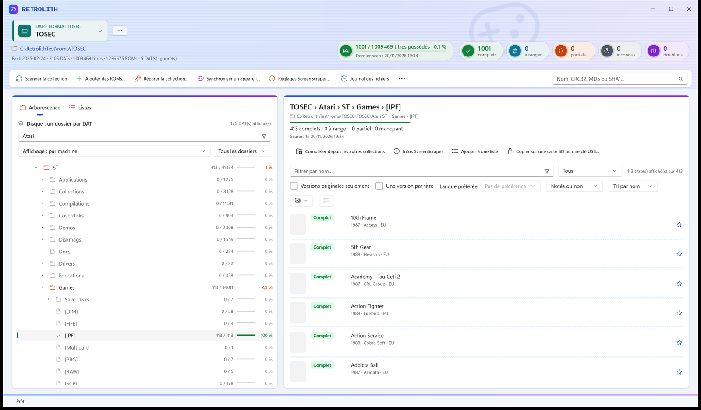

# Premiers pas

[← Sommaire](index.md)

## Installer

1. Téléchargez `Retrolith-<version>-win-x64.zip` sur la
   [page des versions](https://github.com/TiticBE/Retrolith/releases/latest).
2. Décompressez-le dans un dossier où vous pouvez écrire (par exemple `C:\Retrolith`, pas `C:\Program Files`).
3. Lancez `Retrolith.exe`. Si Windows affiche « Windows a protégé votre ordinateur », cliquez sur
   **Informations complémentaires** puis **Exécuter quand même** (voir la [FAQ](faq.md)).

Le dossier contient :

| Élément | Rôle |
|---|---|
| `Retrolith.exe` | Le lanceur, à ouvrir. |
| `App\` | L'application et ses bibliothèques. |
| `Data\` | Vos données : base, réglages, médias, sauvegardes, journaux. Créé au premier lancement. |
| `portable.txt` | Garde les données dans `Data`. Supprimé, Retrolith les range dans `%LOCALAPPDATA%\Retrolith`. |
| `LICENSE.txt`, `THIRD-PARTY-NOTICES.txt` | Licence de Retrolith et des composants tiers. |

Pour déplacer Retrolith, déplacez tout le dossier, Retrolith fermé.

## Créer sa première collection

Au premier lancement, la base est vide. L'écran d'accueil propose deux sortes de collections :

- **Collection de DATs** : pour comparer vos fichiers à des DATs publiés (TOSEC, No-Intro, Redump, MAME…).
- **Catalogue personnel** : pour vos propres fichiers, qu'aucun DAT ne liste (vos dumps, vos créations).

Choisissez, donnez-lui un nom, c'est tout. Les autres actions restent grisées tant qu'il n'y a pas de collection.

## Importer les DATs

Dans l'écran d'accueil, ou plus tard dans le menu de la collection › **Importer des DATs** :

- **Un fichier (zip, dat)…** : le pack tel que vous l'avez téléchargé (zip), ou un seul DAT ;
- **Un dossier de DATs…** : un pack déjà décompressé, sous-dossiers compris.

Retrolith reconnaît le **format des noms** (TOSEC, No-Intro ou Autre) et le dit à la fin de l'import. Réimporter un
pack plus récent ne relit que les DATs qui ont changé ; les jeux ajoutés, retirés et renommés sont notés dans le
journal, et vos listes et notes suivent les jeux renommés. Aucun fichier de la collection n'est touché par un import.

Où trouver les DATs : sur les sites de [TOSEC](https://www.tosecdev.org/),
[No-Intro (Dat-o-Matic)](https://datomatic.no-intro.org/), [Redump](http://redump.org/),
[MAME](https://www.mamedev.org/) et [FinalBurn Neo](https://github.com/finalburnneo/FBNeo).

## Choisir le dossier racine

**Choisir le dossier racine de la collection…** : le dossier où sont vos ROMs, ou un dossier vide où Retrolith les
rangera. Un lecteur réseau convient ; s'il décroche pendant une opération, Retrolith attend son retour et reprend.

## Premier scan

**Scanner la collection** parcourt le dossier racine et rapproche chaque fichier de tous les DATs. Ensuite :

- l'arborescence montre le pourcentage de titres possédés, par machine ou par DAT ;
- les **pastilles** en haut à droite comptent les titres possédés, complets, à ranger, partiels, les fichiers inconnus
  et les doublons ; un clic sur une pastille en donne la liste.

La suite : [ranger ce qui doit l'être](scanning-and-filing.md), [récupérer les infos et les médias](info-and-media.md),
[faire des listes](browsing-and-lists.md) et [les copier sur un appareil](devices.md).
